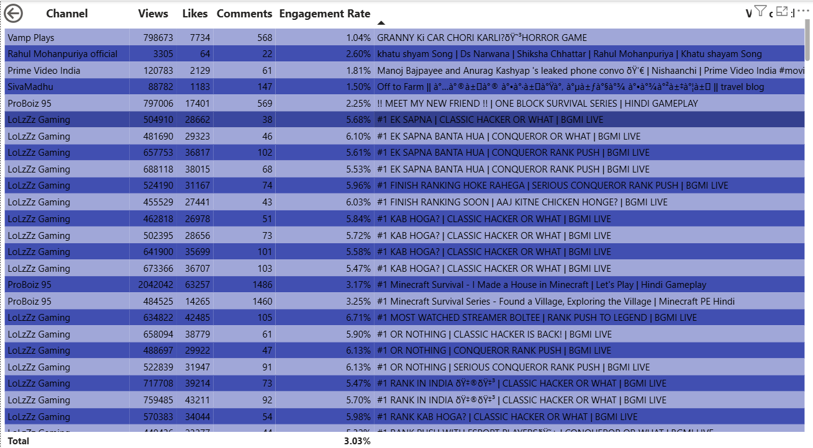
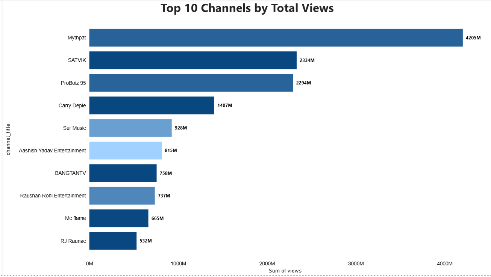
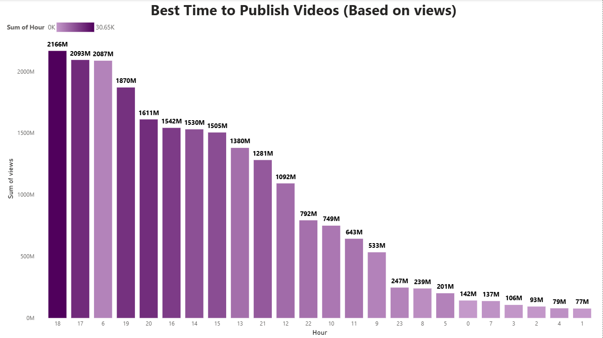

# YouTube Trending Video Analysis – India 🇮🇳

**Tools:** SQL (Microsoft SQL Server) · Power BI · DAX  
**Dataset:** [YouTube Trending Videos – India (Kaggle)](https://www.kaggle.com/datasets/datasnaek/youtube-new)  
**Type:** End-to-End Data Analysis Portfolio Project

---

## Project Overview

What actually makes a video trend on YouTube in India? Is it the category? The channel? The time it was uploaded? Or is raw view count even the right metric to look at?

This project explores those questions using real trending video data from India's YouTube platform. The goal was to go beyond surface-level numbers and uncover the patterns that separate genuinely engaging content from content that simply gets watched.

The analysis was built end-to-end — from raw data cleaning and SQL transformation to interactive Power BI dashboards and insight communication.

---

## What Was Built

### 1. SQL Data Pipeline
- Designed and executed a full data pipeline in Microsoft SQL Server
- Performed DDL operations, data type validation using `TRY_CAST` and `NULLIF`, and null handling
- Built a manually created category lookup table to resolve YouTube API category ID mapping (no API access used)
- Applied advanced T-SQL: `RANK() OVER (PARTITION BY)`, `DATEPART`, `CASE` statements, multi-table `JOIN`s, subqueries, and window functions

### 2. Power BI Dashboards (4 Dashboards)
- Engagement Rate by Category
- Channel-wise Performance Analysis
- Top 10 Channels by Total Views
- Best Time to Publish Videos

---

## The Story: What the Data Revealed

### Chapter 1 — Not All Categories Are Equal

The first question was simple: which type of content actually connects with audiences?

The data showed clear variation in engagement rates across categories — and the pattern was immediately interesting. Categories with the highest engagement were not always the ones with the most videos. Emotionally resonant, entertaining, and relatable content consistently drove stronger audience reactions (likes, comments) than purely informational content.

The critical insight here: **high video volume does not guarantee high engagement**. Some categories flooded the trending list with content but showed relatively weak audience interaction. This tells creators and marketers something important — reach is not the same as resonance.


---

### Chapter 2 — A Few Channels Dominate Everything

Once category patterns were clear, the next question was: who is actually winning?

The channel performance analysis revealed a stark concentration of dominance. A small number of creators consistently appeared multiple times in trending content, with engagement rates of 5–6% — well above the overall average of approximately 3%. Gaming channels stood out particularly, showing sustained high engagement across multiple videos, pointing to loyal, repeat audiences.

But here is where it gets interesting: some channels with massive view counts showed relatively low engagement rates. Meanwhile, channels with moderate views but higher engagement were quietly outperforming them in terms of actual audience connection.

**Reach and resonance are two different things** — and this project made that distinction visible.



---

### Chapter 3 — The Winner-Takes-Most Dynamic

Zooming out to total views across the top 10 channels confirmed what the channel analysis hinted at: YouTube in India follows a winner-takes-most pattern.

The top channel had a substantial gap over the second and third positions. The top three channels collectively accounted for a major share of total views across the entire dataset. Mid-tier channels (ranked 4th to 10th) competed more closely among themselves, but the gap between tier one and the rest was significant.

Diverse content categories appeared in the top 10 — gaming, entertainment, music — which confirmed that no single category monopolizes reach. But what the dominant channels shared was consistent uploads, strong subscriber bases, and clear algorithmic visibility.



---

### Chapter 4 — Timing Is Not Optional

The final piece of the puzzle was timing. Does it actually matter when you publish?

The data said yes — decisively.

Peak viewership concentrated around **5 PM to 7 PM**, aligning with post-work and post-academic hours when audiences shift into leisure mode. A secondary peak appeared in the late afternoon. Early morning and late night showed significantly lower performance across the board.

The gap between peak and off-peak hours was substantial enough to conclude that publishing time directly impacts initial traction — and initial traction is what triggers YouTube's recommendation algorithm. Timing is not a minor detail. It is a strategic decision.



---

## Conclusion

Taken together, the four dashboards tell a coherent story about how YouTube trending works in India.

**Engagement rate is a more meaningful metric than view count.** High views with low engagement signals passive consumption. High engagement with moderate views signals genuine audience connection — and that is what drives long-term growth.

**Content category shapes engagement ceiling.** Creators in emotionally engaging categories start with a structural advantage. Volume alone cannot overcome a low-engagement category.

**Dominance is concentrated.** A small number of channels capture a disproportionate share of attention, driven by consistency, algorithmic visibility, and loyal audiences — not just one viral moment.

**Timing amplifies content.** Even strong content underperforms when published at the wrong hour. Evening slots between 5–7 PM consistently outperformed all other windows.

For creators, marketers, and analysts working with YouTube data — the takeaway is the same: **optimize for engagement, not just reach. Publish in the right category, at the right time, with consistency.**

---

## Repository Structure

```
Youtube-Trending-Video-Analysis/
├── youtube-trending-analysis.sql     # Full SQL data pipeline
├── youtube-trending-analysis.pbix    # Power BI dashboard file
├── engagement_by_category.png        # Dashboard screenshot
├── channel_performance.png           # Dashboard screenshot
├── top_channels_by_views.png         # Dashboard screenshot
├── best_publish_time.png             # Dashboard screenshot
└── README.md
```

---

## About

Built by **Dhruti Raval** as part of a data analyst portfolio.  
📧 dhrutir74@gmail.com  
🔗 [github.com/dhruti-raval](https://github.com/dhruti-raval)
