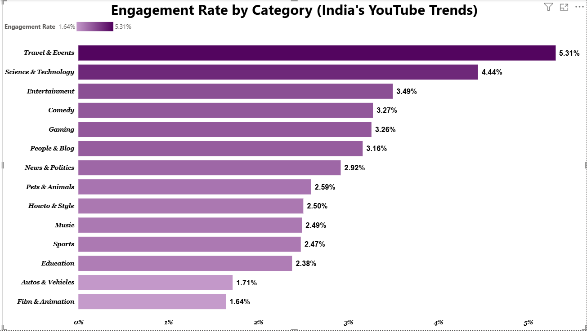

# YouTube Trending Video Analysis – India 🇮🇳

**Tools:** SQL (Microsoft SQL Server) · Power BI · DAX  
**Dataset:** [YouTube Trending Videos – India (Kaggle)](https://www.kaggle.com/datasets/datasnaek/youtube-new)  
**Type:** End-to-End Data Analysis Portfolio Project

---
# YouTube Trending Video Analysis – India 🇮🇳

**Tools:** SQL (Microsoft SQL Server) · Power BI · DAX
**Dataset:** YouTube Trending Videos – India (Kaggle)
**Type:** End-to-End Data Analysis Portfolio Project

---

## Problem Statement

A video with millions of views is not necessarily a video people care about. On YouTube, attention shows up in two ways: **reach** (how many people watched) and **resonance** (how many of them liked or commented). Creators and marketers in India who judge content only by view count can end up backing the wrong categories, the wrong channels and the wrong publishing hours.

This project analyses about 16,200 YouTube videos from India to answer one question: **what separates content that is merely watched from content that genuinely connects with its audience?** It breaks that question into four parts:

1. Which content categories earn the strongest audience response, not just the most videos?
2. Who dominates reach, and is that dominance driven by popular videos or by upload volume?
3. Does high reach go together with high engagement?
4. Does the hour a video is published affect its views?

**Engagement rate** is defined as (likes + comments) / views.

---

## Dataset at a Glance

| | |
|---|---|
| Videos analysed | 16,199 |
| Channels | 980 |
| Total views | about 22.2 billion |
| Overall engagement rate | 3.03% |
| Publish dates | 78% published in 2025–2026 |

---

## What Was Built

### 1. SQL Data Pipeline (SQL Server)
- Converted ISO-format publish timestamps (`2026-02-26T11:41:22Z`) from text to `DATETIME` using `REPLACE` and `TRY_CAST`, then validated the conversion by checking for NULLs and counting valid rows
- Calculated engagement rate with `NULLIF` to avoid division by zero on zero-view videos
- Checked the dislikes column for usable data before removing it from the analysis table
- Built a category lookup table to map YouTube's numeric category IDs to readable names (no API access used) and joined it to the main table
- Ranked videos within each channel using `RANK() OVER (PARTITION BY ...)` and extracted publish hour with `DATEPART`

### 2. Power BI Dashboards (4 pages)
| Page | What it shows |
|---|---|
| Engagement Rate by Category | Engagement rate for categories with at least 100 videos |
| Top 10 Channels by Total Views | Channel reach, with average views and video count in the tooltip |
| Best Time to Publish Videos | Average views per video by hour of day (IST), with video count in the tooltip |
| Video-Level Table | Individual videos sorted by views, with likes, comments and engagement rate |

DAX measures: `Engagement Rate`, `Avg Views`, `Video Count`, plus calculated columns converting UTC publish time to IST and extracting the IST hour.

---

## Findings

### 1. Which categories earn the strongest response?



Six categories with 100 or more videos cover 98.5% of the data. Among them:

| Category | Videos | Engagement rate |
|---|---|---|
| Entertainment | 3,070 | 3.49% |
| Gaming | 4,901 | 3.26% |
| People & Blogs | 858 | 3.16% |
| News & Politics | 149 | 2.92% |
| Music | 6,610 | 2.49% |
| Film & Animation | 351 | 1.64% |

- Entertainment, Gaming and People & Blogs are close together, so none of them is a clear winner.
- **Music is the largest category (about 41% of all videos) but engages below the 3.03% average.** Volume did not buy resonance.
- Categories with fewer than 100 videos were left out of the chart. Travel & Events (5.31%, 13 videos) and Science & Technology (4.44%, 49 videos) look strongest, but a handful of videos can swing a rate that small.

### 2. Who dominates reach, and why?


- **Reach is concentrated.** The top 3 channels (Mythpat, SATVIK, ProBoiz 95) hold 39.8% of all views, and the top 10 hold 66.1%, out of 980 channels.
- **Mythpat leads with 4.2 billion views on fewer videos than the runner-up** (429 vs 500). He averages about 9.8M views per video against SATVIK's 4.7M, so per-video popularity, not upload volume, put him first.
- SATVIK edges out ProBoiz 95 for second place on volume: ProBoiz 95 averages more per video (about 5.4M) but has fewer videos (426 vs 500).
- **Several top-10 channels reach huge audiences with very low engagement:** Carry Depie (0.88%), Sur Music (0.81%) and Aashish Yadav Entertainment (0.88%). In contrast, BANGTANTV (11.6%), RJ Raunac (5.1%) and Mythpat (4.7%) combine reach with strong response.

### 3. Does high reach mean high engagement?


No. In the video-level table, Sur Music's top video has about 274M views but only 0.55% engagement, while Mythpat's 69M-view video reaches 5.09%. Engagement rate says something view count cannot: how much of the audience reacted.

### 4. Does publishing time matter?


Publish times were converted from UTC to IST, then averaged per video for each hour of the day.

- **Noon IST is the most dependable strong hour:** about 2.2M average views across 504 videos.
- 4 AM IST has the highest average (2.55M) but only 246 videos behind it, so it is not treated as reliable. 2 AM (1.96M, 721 videos) and 7 PM (1.78M, 909 videos) are also strong.
- The weakest hour, 10 AM IST, averages only 0.16M, so the best well-supported hour (noon) averages about 14 times more.
- There is no single "evening peak". 5 PM and 6 PM average 1.35M and 1.64M, below noon.

---

## Analytical Decisions

- **Average, not sum, for publishing time.** Summing views by hour only measures how many videos were uploaded in that hour. The average per video measures how well they performed.
- **Minimum of 100 videos per category.** Small groups give unstable averages; the exclusion is stated on the dashboard.
- **Ratio of totals for engagement.** Engagement is (total likes + total comments) / total views, so large videos carry more weight than small ones.
- **UTC to IST.** Source timestamps carry a `Z` (UTC). They were shifted by 5 hours 30 minutes before taking the hour, because a half-hour offset cannot be fixed by adding to the hour number alone.
- **Video counts beside every average.** Each average shows how many videos stand behind it.

---

## Limitations

- **Per-channel cap in the data.** No channel has more than 500 videos, and 22 channels sit at exactly 500 (about 68% of all rows come from them). This looks like a collection limit, so channel totals and video counts for those channels are lower bounds, and the dataset may not be a pure record of the trending list.
- Hour of day is the **publish** hour, not the hour a video started trending.
- Averages can be pulled up by a few viral videos; medians were not checked.
- 196 rows have no `video_id`, and some non-English titles display with broken characters because of a text-encoding issue on import.
- Findings describe this dataset and do not prove why audiences behave this way.

---

## Takeaways

- Judge content by engagement as well as views. High views with low engagement points to passive consumption.
- Large categories are not automatically engaged ones. Music is the biggest and engages below average.
- Reach is concentrated in a few channels, and the leaders win in different ways: Mythpat on per-video popularity, SATVIK on volume.
- When choosing a publishing hour, check how many videos stand behind each average before trusting it.

---

## Repository Structure

```
├── README.md
├── sql/                         # SQL Server scripts
├── powerbi/                     # .pbix file
├── engagement_by_category.png
├── top_channels_by_views.png
├── best_publish_time.png
└── video_table.png
```

## About

Built by **Dhruti Raval** as part of a data analyst portfolio.  
📧 dhrutir74@gmail.com  
🔗 [github.com/dhruti-raval](https://github.com/dhruti-raval)
